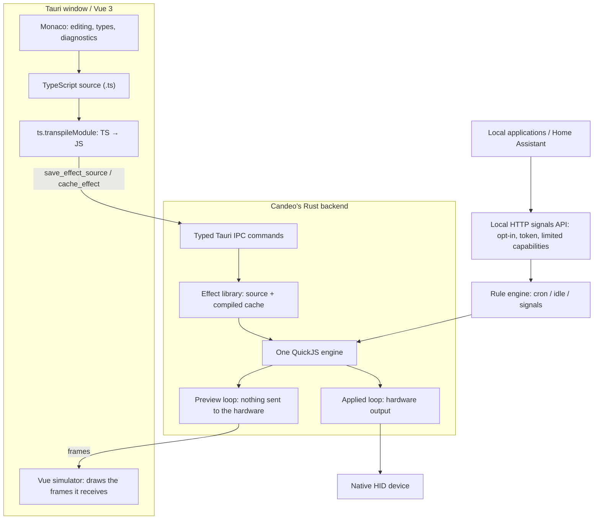
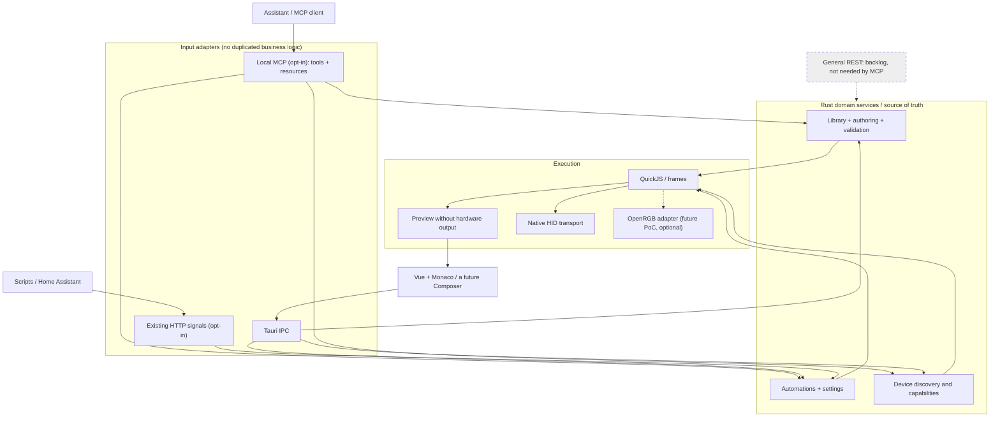
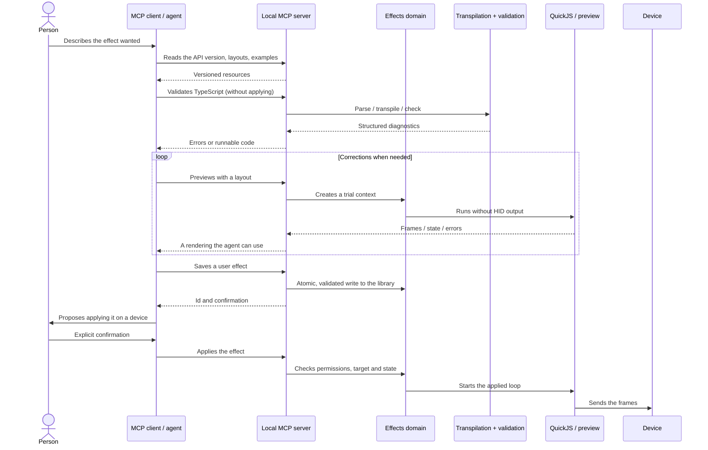

# Candeo — effect architecture and an agent interface (proposal)

> **Status: proposal, not implemented.** This note tells what the repository does
> today apart from the design considered. It complements [`studio.md`](studio.md),
> [`effects-library.md`](effects-library.md),
> [`inputs-and-automations.md`](inputs-and-automations.md) and
> [issue #359](https://github.com/o2csi/candeo/issues/359) (MCP).
>
> The goal: let an MCP-compatible agent create, validate and preview an effect,
> then propose applying it, without manual copy and paste. **No lighting change
> may result from generating or previewing alone.** No network service is turned
> on implicitly.

## 1. The architecture today — checked in the repository

**Checked in:** `apps/desktop/src/editor/effect.ts`, `apps/desktop/src/editor/library.ts`,
`apps/desktop/src/views/EditorView.vue`, `apps/desktop/src-tauri/src/storage.rs`,
`docs/api/commands.md`. The window compiles TypeScript sources with the compiler
Monaco ships. Preview and applied rendering use the same QuickJS runtime; only the
applied loop writes to the hardware.

The HTTP **signals** API exists already. It is **not** a general control API: the
sender supplies named values, and the person decides in the application which
rules they trigger.

## 2. The target architecture — to validate before implementing

**Principle:** MCP, Tauri IPC and the HTTP signals API do not talk to each other;
each calls the shared domain services. **No general REST API** is needed by MCP.
A full REST API stays out of scope until someone needs it.

The services layer is a **refactoring target**, not a module that already exists
under that name.

## 3. Effects created by an agent: the proposed flow

The MCP tools are **proposed**, not implemented: `list_effects`, `get_layout`,
`validate_effect`, `preview_effect`, `save_effect`, `apply_effect`,
`list_automations`. The person's confirmation must be enforced by the product's
policy and by the server for sensitive operations, not rest on the agent's good
intentions alone.

### Documentation for agents

- Source of truth: `@candeo/effects-api`, its types, documentation, examples and
  the API version actually installed.
- Recommended **MCP resource**: `candeo://effects-api` (a summary of the
  documentation and its version), possibly with `candeo://examples`. No redundant
  `get_effect_api` tool is needed when the client reads resources.
- An optional, derived **SKILL.md** for agents that install skills: how to use it
  and the workflow, **not** a copy of the API schema that could drift.
- Capability metadata, so that an agent adapts its calls to the local version.

## 4. The TypeScript compiler — an open decision

**Today:** the TypeScript service shipped with Monaco produces the diagnostics and
runs `transpileModule` in the WebView. Monaco's plain syntax colouring does not
depend on the Rust backend having a compiler, but its semantic diagnostics,
completion and type tooling depend on the editor's TypeScript service.

**The likely need:** an MCP server reachable without an open window must not
depend on a call into a hidden WebView. A TS → JS transpilation on the Rust side
is to be studied. **Oxc** is a native candidate: it parses and transforms
TypeScript; it does not by itself replace TypeScript's full semantic checking.

To decide through a PoC (#364), with the shipped effects and adversarial cases:

1. Compare the JS emitted by Monaco's TypeScript and by Oxc: ESM format,
   `@candeo/effects-api` imports, syntax, and an ES2020 / QuickJS target.
2. Measure the differences in diagnostics, binary size, startup time, memory and
   dependency footprint.
3. Test syntax errors, type errors, malicious code, timeouts, an unknown API,
   unsaved sources.
4. Keep **one shared validation contract** for Tauri IPC and MCP: no silent
   divergence in behaviour.
5. Do not replace Monaco's compiler on principle; keep the editor and its
   TypeScript features.

**Result of the PoC (#364):** Oxc, under conditions. Every shipped and typed
effect renders the same frames through Oxc as through `transpileModule`, about
30 times faster, for about 2.3 MiB of binary. The conditions: settings for
TypeScript's class-field semantics, a size limit and a large stack because Oxc
can crash the process on deep nesting, one Rust validation contract shared by
IPC and MCP, and Rust 1.97. Types stay with the editor; TypeScript's checker
running in QuickJS is the measured option for an explicit check. Tables,
differences and what remains: [`headless-transpile-poc.md`](headless-transpile-poc.md).

## 5. Access, safety and scope

- MCP **off by default**, local only, needing neither the Internet nor an account.
- Choose `stdio` or Streamable HTTP according to the clients aimed at and Tauri's
  lifecycle; over HTTP, protect the endpoint with authentication and
  authorisation, and with Origin / DNS-rebinding checks. `127.0.0.1` alone is not
  authentication.
- Reading and previewing must neither touch the hardware nor change automations.
- Writes limited to user effects and the typed operations designed for them: no
  arbitrary file system access, no raw HID commands, no implicit upload of
  diagnostics or telemetry.
- Code from an agent is untrusted: keep QuickJS's sandbox, quotas and
  validations, path and size checks, a bounded local log.
- `save`, `preview` and `apply` kept apart. Ask for confirmation before any
  hardware action, before replacing an active effect, and before changing rules.
- **No general REST server in this work.**

## 6. Questions for the decision record

- MCP transport and host process (in the Tauri process, or a local sidecar).
- Headless transpilation: Oxc, another option, or a bounded reuse of the existing
  pipeline. Measured in [`headless-transpile-poc.md`](headless-transpile-poc.md):
  Oxc, under the conditions of its §6.
- Rendering preview frames as an image without duplicating the simulator's
  geometry.
- Output schemas, resource versioning and standard errors.
- The consent model for applied effects and changed automations.

**External references (inspiration, not an implementation to copy):**

- Hypercolor's [MCP](https://github.com/hyperb1iss/hypercolor/blob/main/docs/content/api/mcp.md)
  and [authoring](https://github.com/hyperb1iss/hypercolor/blob/main/crates/hypercolor-daemon/src/mcp/tools/authoring.rs):
  `install_effect` + `get_effect_console` + `capture_canvas`.
- Hypercolor runs **standalone HTML effects** (often built from TypeScript with
  Bun). **Candeo does not run HTML effects**: it runs JS transpiled from TS effects,
  in QuickJS.
