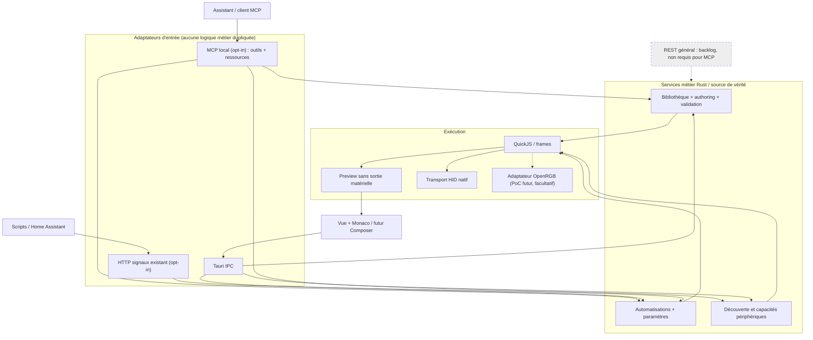
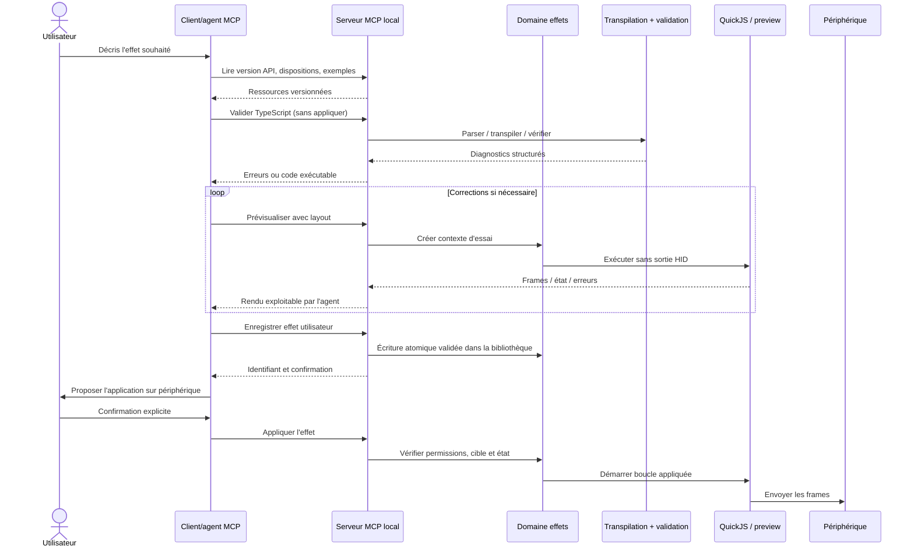

# Candeo — architecture des effets et interface agentique (proposition)

> **Statut : proposition, non implémentée.** Cette note distingue la réalité du dépôt du design envisagé. Elle complète [`studio.md`](studio.md), [`effects-library.md`](effects-library.md), [`inputs-and-automations.md`](inputs-and-automations.md) et l'[issue MCP #359](https://github.com/o2csi/candeo/issues/359).
>
> Objectif : permettre à un agent compatible MCP de créer, valider, prévisualiser puis proposer l'application d'un effet, sans copier-coller manuel. **Aucune modification de l'éclairage ne doit résulter d'une simple génération ou prévisualisation.** Aucun service réseau n'est activé implicitement.

## 1. Architecture actuelle — vérifiée dans le dépôt

**Points de vérification :** `apps/desktop/src/editor/effect.ts`, `apps/desktop/src/editor/library.ts`, `apps/desktop/src/views/EditorView.vue`, `apps/desktop/src-tauri/src/storage.rs`, `docs/api/commands.md`. Le frontend compile les sources TypeScript avec le compilateur livré par Monaco. Le rendu de preview et le rendu appliqué utilisent le même runtime QuickJS ; seule la boucle appliquée écrit sur le matériel.

L'API HTTP de **signaux** existe déjà. Ce n'est **pas** une API de contrôle général de Candeo : l'émetteur fournit des valeurs nommées et l'utilisateur décide dans l'application des règles qu'elles déclenchent.

## 2. Architecture cible — à valider avant implémentation

**Principe :** MCP, Tauri IPC et l'API HTTP de signaux ne se parlent pas entre eux ; ils sollicitent les services métier communs. **Aucune API REST généraliste** n'est requise par le MCP. Le REST complet reste hors périmètre tant qu'un consommateur n'est pas identifié.

La couche de services est une **cible de refactoring**, pas un module unique déjà présent sous ce nom.

## 3. Création d'effets par agent : flux proposé

Les outils MCP sont **proposés**, pas implémentés : `list_effects`, `get_layout`, `validate_effect`, `preview_effect`, `save_effect`, `apply_effect`, `list_automations`. La confirmation de l'utilisateur doit être imposée par la politique du produit et le serveur pour les opérations sensibles, et ne doit pas reposer exclusivement sur les bonnes intentions de l'agent.

### Fourniture de documentation aux agents

- Source de vérité : `@candeo/effects-api`, types, documentation, exemples et version d'API réellement installée.
- **MCP resource** recommandée : `candeo://effects-api` (documentation synthétique et version), éventuellement complétée par `candeo://examples`. Pas besoin d'un outil redondant `get_effect_api` si le client sait lire les ressources.
- **SKILL.md** optionnel et dérivé, pour guider les agents qui installent un skill : mode d'emploi et workflow, **pas** copie divergente du schéma d'API.
- Fournir des métadonnées de capacités pour qu'un agent adapte ses appels à la version locale.

## 4. Compiler TypeScript — décision ouverte

**État actuel :** le service TypeScript fourni avec Monaco réalise les diagnostics et `transpileModule` dans la WebView. La coloration syntaxique simple de Monaco ne dépend pas du fait que le backend Rust dispose d'un compilateur, mais ses diagnostics sémantiques, sa complétion et l'outillage de types dépendent du service TypeScript côté éditeur.

**Besoin potentiel :** un MCP accessible même sans fenêtre active ne doit pas dépendre d'un appel à une WebView cachée. Étudier une transpilation TS → JS côté Rust. **Oxc** est un candidat natif : parser et transformer TypeScript ; il ne remplace pas automatiquement la vérification sémantique complète de TypeScript.

Décider par un PoC avec les effets fournis et des cas adverses :
1. Comparer JS émis par Monaco TypeScript et Oxc, format ESM, imports `@candeo/effects-api`, syntaxe et cible ES2020 / QuickJS.
2. Mesurer différences de diagnostics, taille binaire, temps de démarrage, mémoire et empreinte des dépendances.
3. Tester erreurs de syntaxe, erreurs de types, code malveillant, timeouts, API inconnue, sources non sauvegardées.
4. Retenir **un contrat de validation partagé** utilisable par Tauri IPC et MCP : aucune divergence silencieuse de comportement.
5. Ne pas remplacer le compilateur de Monaco par principe ; préserver l'éditeur et ses fonctionnalités TypeScript.

## 5. Accès, sécurité et périmètre

- MCP **désactivé par défaut**, uniquement local, aucune exigence d'Internet ou de compte.
- Choisir `stdio` ou Streamable HTTP selon les clients visés et le cycle de vie Tauri ; si HTTP, protéger l'endpoint par authentification/autorisation et contrôles Origin / DNS rebinding. `127.0.0.1` seul n'est pas une authentification.
- Lire et prévisualiser ne doivent ni toucher au matériel ni modifier les automatisations.
- Restreindre les écritures aux effets utilisateur et opérations typées prévues ; pas d'accès arbitraire au système de fichiers, pas de commandes HID brutes, pas d'upload implicite de diagnostics ou de télémétrie.
- Code agent non fiable : conserver sandbox QuickJS, quotas et validations, tests de chemins et de taille, journal local limité.
- Séparer `save`, `preview` et `apply`. Demander confirmation avant toute action matérielle, remplacement d'effet actif ou modification des règles.
- **Pas de serveur REST généraliste dans ce chantier.**

## 6. Questions à trancher dans l'ADR

- Transport MCP et processus hôte (in-process Tauri vs sidecar local).
- Transpilation tête-less : Oxc, autre option, ou réutilisation encadrée du pipeline existant.
- Rendu des frames de preview au format image sans dupliquer l'algorithme de géométrie du simulateur.
- Schémas de sortie, versionnement des ressources et erreurs standardisées.
- Modèle de consentement pour effets appliqués et automatisations modifiées.

**Références externes (inspiration, non implémentation à copier) :**
- Hypercolor [MCP](https://github.com/hyperb1iss/hypercolor/blob/main/docs/content/api/mcp.md) et [authoring](https://github.com/hyperb1iss/hypercolor/blob/main/crates/hypercolor-daemon/src/mcp/tools/authoring.rs) : `install_effect` + `get_effect_console` + `capture_canvas`.
- Hypercolor utilise des **effets HTML autonomes** (souvent produits depuis TypeScript via Bun). **Candeo n'exécute pas d'effets HTML** : il exécute du JS transpilé depuis des effets TS via QuickJS.
